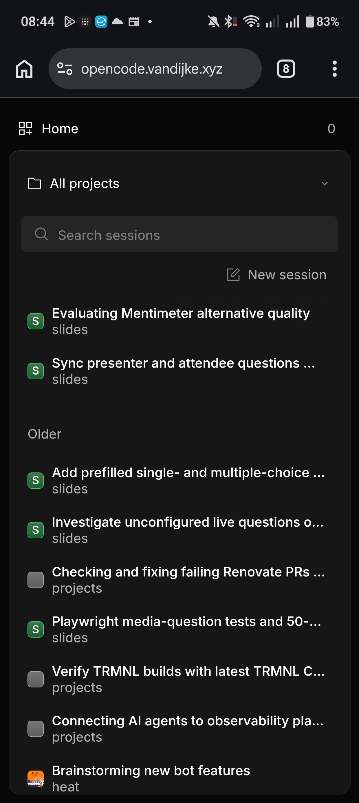
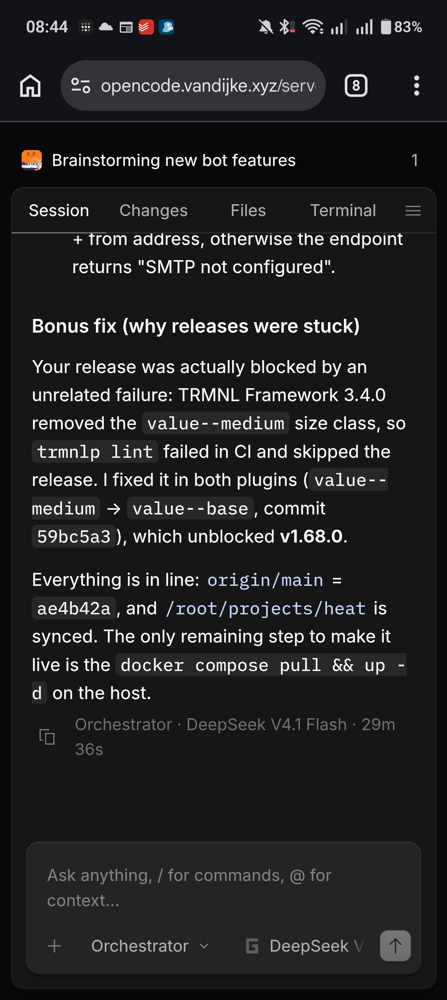
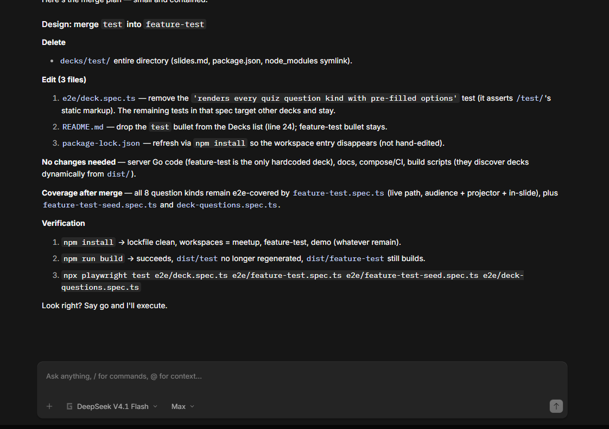

<div class="absolute inset-0">
  <div class="absolute inset-0" style="background: radial-gradient(800px circle at 20% 10%, rgba(109,40,217,0.35), transparent 60%), radial-gradient(700px circle at 90% 80%, rgba(6,182,214,0.22), transparent 60%), radial-gradient(600px circle at 60% -10%, rgba(163,230,53,0.12), transparent 60%);"></div>
  <div class="absolute inset-0 opacity-[0.035]" style="background-image: url('https://grainy-gradients.vercel.app/noise.svg');"></div>
</div>

<div class="relative z-10 h-full flex flex-col justify-center text-left max-w-5xl mx-auto px-2">


# OpenCode

<div class="text-[15px] md:text-[19px] font-light leading-relaxed text-white/70 max-w-[640px] mt-3">

**Agentic development @ Home** <br><br>
**Opencode : The open source AI coding agent** — TUI · Desktop · Web.<br>
**Opencode Go: The cheap AI subscription**

</div>

<div class="flex flex-wrap gap-3 mt-6">
  <span class="px-3 py-1.5 rounded-full bg-white text-black text-xs font-semibold tracking-wide">Provider-agnostic · 75+ providers</span>
  <span class="px-3 py-1.5 rounded-full bg-violet-600 text-white text-xs font-semibold">Go: $10/mo open models →</span>
</div>

<div class="flex items-center gap-4 mt-6 text-[11px] font-mono text-white/40">
  <span>What it is → How it works → Console → Running @ Home → On your phone</span>
</div>


</div>

<div class="absolute bottom-6 right-8 text-[10px] font-mono tracking-widest text-white/25">ESC → OVERVIEW · PRESS → NEXT</div>

<!--
Speaker notes: New framing — OpenCode is the whole story, Go is one chapter. This deck walks the full arc: agent → providers → Console (team/billing) → Go subscription → home server → phone → sharing → Zen vs Go. By Anomaly. Set expectations that Go is optional.
-->

---
layout: iframe
url: https://commit-history.com/martynvdijke
---

---
layout: iframe
url: https://sandwitches.vandijke.xyz/
---

---
layout: center
---


<div class="text-[11px] tracking-[0.2em] uppercase font-mono text-zinc-400 mb-3">01 — The agent</div>

## What is <span class="font-serif italic">OpenCode?</span>

<div class="text-[13px] leading-relaxed text-zinc-600 mt-3">

The **open source AI coding agent by Anomaly.** <br>
Source code https://github.com/anomalyco/opencode <br>
Its a open-source agent harness, bring your own model.

A harness is the "wrapper" layer around a model, file interactions, tool interactions etc.

</div>

<div class="grid grid-cols-2 gap-3 mt-5">

<div class="rounded-xl border border-zinc-200 p-3 bg-zinc-50/60">
  <div class="text-xs font-semibold flex items-center gap-1.5"><span class="i-carbon-terminal text-base opacity-60"></span> Terminal TUI</div>
  <div class="text-[11px] text-zinc-500 mt-1">LSP-aware, multi-session, parallel agents.</div>
</div>

<div class="rounded-xl border border-zinc-200 p-3 bg-white">
  <div class="text-xs font-semibold flex items-center gap-1.5"><span class="i-carbon-application text-base opacity-60"></span> Desktop App</div>
  <div class="text-[11px] text-zinc-500 mt-1">Native wrapper around the same server.</div>
</div>

<div class="rounded-xl border border-zinc-200 p-3 bg-white">
  <div class="text-xs font-semibold flex items-center gap-1.5"><span class="i-carbon-code text-base opacity-60"></span> IDE Extension</div>
  <div class="text-[11px] text-zinc-500 mt-1">Bring the agent where you code.</div>
</div>

<div class="rounded-xl border border-violet-200 p-3 bg-violet-50/60">
  <div class="text-xs font-semibold flex items-center gap-1.5"><span class="i-carbon-globe text-base opacity-60"></span> Web UI</div>
  <div class="text-[11px] text-zinc-500 mt-1">Browser UI from same server. <code class="text-[11px]">opencode web</code></div>
</div>

</div>

---
layout: two-cols
class: gap-6 px-2
---



::right::



---
layout: center
---



<!--
Notes: OpenCode is the agent; Go/Zen are just gateway entries. Emphasize Anomaly as builder and provider-agnostic design.
-->

---
layout: two-cols
class: gap-6 px-4
---


<div class="text-[11px] tracking-[0.2em] uppercase font-mono text-zinc-400 mb-3">02 — How it works</div>

## One server, <span class="font-serif italic">many surfaces</span>

<div class="text-sm text-zinc-600 leading-relaxed mt-2">OpenCode is a <b>local server</b>.The TUI, desktop, IDE and Web are just views — same sessions, same filesystem, same state.</div>

<div class="mt-5 rounded-2xl border border-zinc-200 bg-white p-4">
  <div class="flex items-center justify-center gap-2">
    <div class="rounded-xl border-2 border-zinc-900 bg-zinc-50 px-4 py-3 text-center min-w-[130px]">
      <div class="text-[10px] font-mono tracking-widest text-zinc-500">SERVER</div>
      <div class="text-xs font-bold">opencode</div>
      <div class="text-[11px] text-zinc-500">127.0.0.1:4096</div>
      <div class="text-[10px] font-mono text-zinc-400 mt-1">opencode serve / web</div>
    </div>
  </div>
  <div class="mt-3 grid grid-cols-4 gap-2">
    <div class="rounded-xl border border-zinc-200 bg-zinc-50 p-2.5 text-center">
      <div class="text-xs font-semibold">TUI</div>
      <div class="text-[10px] text-zinc-500">terminal</div>
    </div>
    <div class="rounded-xl border border-zinc-200 bg-white p-2.5 text-center">
      <div class="text-xs font-semibold">Desktop</div>
      <div class="text-[10px] text-zinc-500">app</div>
    </div>
    <div class="rounded-xl border border-zinc-200 bg-white p-2.5 text-center">
      <div class="text-xs font-semibold">IDE</div>
      <div class="text-[10px] text-zinc-500">extension</div>
    </div>
    <div class="rounded-xl border border-violet-200 bg-violet-50 p-2.5 text-center">
      <div class="text-xs font-semibold">Web</div>
      <div class="text-[10px] text-zinc-500">browser</div>
    </div>
  </div>
  <div class="text-[11px] text-zinc-500 mt-3 text-center leading-relaxed">One filesystem · one session store · <code class="text-xs">opencode attach</code> to join from anywhere</div>
</div>

::right::

<div class="rounded-2xl bg-zinc-900 text-white p-4">
  <div class="text-[11px] font-mono tracking-widest text-white/50 uppercase">Attach</div>
  <div class="text-xs text-white/70 mt-2 leading-relaxed">Start the server once, attach many clients.
  Web + TUI drive the <b class="text-white">same session</b>.</div>
</div>

```bash
# headless server
opencode serve --port 4096 --hostname 127.0.0.1

# web = server + browser
opencode web

# attach a second TUI to the running server
opencode attach http://localhost:4096
```

<div class="rounded-xl border border-zinc-200 bg-zinc-50 p-3 -mt-2">
  <div class="text-xs font-bold">Why local-first?</div>
  <ul class="text-xs text-zinc-600 mt-1.5 space-y-1 leading-relaxed list-disc pl-4">
    <li>Swap providers per session without migration.</li>
    <li>Share only when you choose (<code class="text-[11px]">/share</code>).</li>
  </ul>
</div>


<!--
Notes: Mental model first — server is the truth. All surfaces are thin clients. This sets up home server + phone later.
-->

---
layout: center
class: text-center
---

<div class="max-w-3xl mx-auto">

<div class="inline-flex items-center gap-2 px-3 py-1 rounded-full border border-zinc-200 bg-white text-zinc-600 text-xs font-medium">
  <span class="w-1.5 h-1.5 rounded-full bg-violet-600"></span>
  Provider-agnostic by design
</div>

## Models & providers — <span class="font-serif italic font-normal">your choice</span>

<div class="grid grid-cols-3 gap-4 text-left mt-8">

<div class="rounded-2xl border border-zinc-200 p-4 bg-white text-left">
  <div class="text-2xl">🔌</div>
  <div class="text-sm font-semibold mt-2">75+ providers</div>
  <div class="text-xs text-zinc-500 mt-1 leading-relaxed">Via Models.dev / AI SDK — incl. local <b>Ollama · LM Studio · llama.cpp</b>. One config, many backends.</div>
</div>

<div class="rounded-2xl border border-zinc-200 p-4 bg-white text-left">
  <div class="text-2xl">🌐</div>
  <div class="text-sm font-semibold mt-2">Inference gateway</div>
  <div class="text-xs text-zinc-500 mt-1 leading-relaxed">The OpenCode Console is the optional AI gateway.</div>
</div>

<div class="rounded-2xl border border-violet-200 p-4 bg-violet-50/70 text-left">
  <div class="text-2xl">🔓</div>
  <div class="text-sm font-semibold mt-2">Curated open models</div>
  <div class="text-xs text-zinc-500 mt-1 leading-relaxed">OpenCode Go: $10/mo for reliable access to popular <b>open coding models</b>.</div>
</div>

</div>
</div>

<!--
Notes: Frame Go/Zen as gateway entries within the broader provider story, not the whole product.
-->

---
layout: default
class: px-6
---

<div class="text-[11px] tracking-[0.2em] uppercase font-mono text-zinc-400 mb-2">03 — Provider routing</div>

## OpenCode is the <span class="font-serif italic">harness between code and models</span>

<div class="text-sm text-zinc-600 leading-relaxed mt-2">The harness manages sessions, context and tools. It sends each model request to the endpoint for the provider/model you selected.</div>

<div class="grid grid-cols-[0.8fr_auto_1.1fr_auto_1.5fr] gap-3 items-center mt-6">
  <div class="rounded-lg border border-zinc-200 bg-white p-4 text-center">
    <div class="text-[10px] font-mono tracking-widest text-zinc-400">CLIENT</div>
    <div class="text-sm font-semibold mt-2">TUI · IDE · Web</div>
    <div class="text-[11px] text-zinc-500 mt-1">Your prompt + session</div>
  </div>

  <div class="text-xl text-zinc-300">→</div>

  <div class="rounded-lg bg-zinc-900 text-white p-4 text-center">
    <div class="text-[10px] font-mono tracking-widest text-white/50">HARNESS</div>
    <div class="text-sm font-semibold mt-2">OpenCode</div>
    <div class="text-[11px] text-white/65 mt-1">Context · tools · permissions · model choice</div>
  </div>

  <div class="text-xl text-zinc-300">→</div>

  <div class="grid gap-2">
    <div class="rounded-lg border border-zinc-200 bg-white px-3 py-2 flex items-center justify-between">
      <span class="text-xs font-semibold">Hosted provider</span><span class="text-[10px] font-mono text-zinc-400">API endpoint</span>
    </div>
    <div class="rounded-lg border border-zinc-200 bg-white px-3 py-2 flex items-center justify-between">
      <span class="text-xs font-semibold">OpenAI-compatible</span><span class="text-[10px] font-mono text-zinc-400">custom URL</span>
    </div>
    <div class="rounded-lg border border-emerald-200 bg-emerald-50 px-3 py-2 flex items-center justify-between">
      <span class="text-xs font-semibold">Local runtime</span><span class="text-[10px] font-mono text-emerald-700">Ollama · DeepSeek · Kimi K3, etc </span>
    </div>
  </div>
</div>

<div class="grid grid-cols-2 gap-4 mt-5">
  <div class="rounded-lg border border-zinc-200 bg-zinc-50 p-3">
    <div class="text-[10px] font-mono tracking-widest text-zinc-400 uppercase">When the model needs a tool</div>
    <div class="text-xs text-zinc-600 mt-1.5 leading-relaxed">Model returns a tool call → OpenCode checks permissions and runs it → tool result goes back to the model → final response returns to you.</div>
  </div>
  <div class="rounded-lg border border-violet-200 bg-violet-50/60 p-3">
    <div class="text-[10px] font-mono tracking-widest text-violet-600 uppercase">Plug in more than one</div>
    <div class="text-xs text-zinc-600 mt-1.5 leading-relaxed">Connect credentials and configure multiple providers once. Select or switch the provider/model per session; each request goes to the selected endpoint, not every endpoint.</div>
  </div>
</div>


<!--
Notes: OpenCode is the orchestration layer, not the model host. Requests route to the chosen provider/model endpoint. The harness handles tool calls and feeds tool results back into the model loop.
-->

---
layout: center
class: text-center 
---

<div class="max-w-3xl mx-auto">

<div class="inline-flex items-center gap-2 px-3 py-1 rounded-full border border-amber-200 bg-amber-50 text-amber-800 text-xs font-medium">
  <span class="w-1.5 h-1.5 rounded-full bg-amber-500 animate-pulse"></span>
  The problem with “just use Antprohic / OpenAI”
</div>

## Frontier models are <span class="font-serif italic font-normal">amazing</span> — and <span class="text-zinc-400 line-through decoration-amber-400 decoration-2">expensive</span>

<div class="grid grid-cols-3 gap-4 text-left mt-8">

<div class="rounded-2xl border border-zinc-200 p-4 bg-white">
  <div class="text-2xl">💸</div>
  <div class="text-sm font-semibold mt-2">Spiky costs</div>
  <div class="text-xs text-zinc-500 mt-1 leading-relaxed">Per-token meters spin fast in long coding sessions.</div>
</div>

<div class="rounded-2xl border border-zinc-200 p-4 bg-white">
  <div class="text-2xl">⏳</div>
  <div class="text-sm font-semibold mt-2">Capacity crunches</div>
  <div class="text-xs text-zinc-500 mt-1 leading-relaxed">Rate limits & queues when everyone ships.</div>
</div>

<div class="rounded-2xl border border-violet-200 p-4 bg-violet-50/70">
  <div class="text-2xl">🔓</div>
  <div class="text-sm font-semibold mt-2">You want options</div>
  <div class="text-xs text-zinc-500 mt-1 leading-relaxed">Open models are fast, cheap, improving and constanslty changing.</div>
</div>

</div>


</div>

---
layout: iframe
url: https://artificialanalysis.ai/models#cost-tabs
---

---
layout: iframe
url: https://artificialanalysis.ai/models#intelligence
---

---
layout: iframe
url: https://artificialanalysis.ai/models#intelligence-category-tabs
---

---
layout: default
---

<div class="text-[11px] tracking-[0.2em] uppercase font-mono text-zinc-400 mb-2">07 — The lineup</div>

## The model lineup <span class="font-serif italic font-normal text-zinc-500">curated open models · tiers by monthly usage</span>

<div class="text-[11px] text-zinc-500 -mt-1 mb-4">List may change — check <span class="font-mono text-xs">opencode.ai/go</span> and <span class="font-mono text-xs">GET /zen/go/v1/models</span>.</div>

<div class="grid md:grid-cols-1 gap-3">

<div class="rounded-2xl border border-violet-200 bg-violet-50/50 p-4">
  <div class="mt-3 flex flex-wrap gap-1.5">
    <span class="model-chip">GLM-5.3-Flash</span>
    <span class="model-chip">Kimi K2.7 Code</span>
    <span class="model-chip">MiniMax M3</span>
    <span class="model-chip">MiniMax M2.7</span>
    <span class="model-chip">MiniMax M2.5</span>
    <span class="model-chip">Qwen3.7 Plus</span>
    <span class="model-chip">LongCat-2.0</span>
    <span class="model-chip">MiMo-V2.6-Flash</span>
    <span class="model-chip">MiMo-V2.5</span>
    <span class="model-chip">DeepSeek V4 Flash</span>
    <span class="model-chip">Hy3</span>
    <span class="model-chip">Muse Spark 1.3</span>
    <span class="model-chip">GLM-5.3</span>
    <span class="model-chip">GLM-5.2</span>
    <span class="model-chip">GLM-5.1</span>
    <span class="model-chip">Kimi K3</span>
    <span class="model-chip">Qwen3.8 Max</span>
    <span class="model-chip">Grok 4.7</span>
    <span class="model-chip">Grok 4.6</span>
    <span class="model-chip">GPT 6 Luna</span>
    <span class="model-chip">GPT 5.6 Luna</span>
    <span class="model-chip">DeepSeek V4 Pro</span>
    <span class="model-chip">DeepSeek V4.1 Flash</span>
    <span class="model-chip">MiMo-V2.6-Pro</span>
    <span class="model-chip">MiMo-V2.5-Pro</span>
    <span class="model-chip">Hy4 preview</span>
  </div>
</div>

</div>

---
layout: section
class: gap-6 px-2
---

<div class="text-[11px] tracking-[0.3em] uppercase font-mono text-white/50 mb-4">At home</div>

# Run OpenCode <span class="font-serif italic font-light">at home</span> — always-on

<div class="text-sm text-white/60 mt-3 max-w-2xl mx-auto leading-relaxed">

Home server · mini-PC · Raspberry Pi · NAS. A headless <code class="text-white/80">opencode serve</code> you can reach from any device on your LAN — TUI, Web, or phone.

</div>

<div class="mt-8 inline-flex flex-wrap items-center justify-center gap-2 px-4 py-2 rounded-full bg-white text-zinc-900 font-mono text-sm shadow-xl">
  <span class="w-2 h-2 rounded-full bg-emerald-500 animate-pulse"></span> opencode serve
  <span class="text-zinc-400">+</span> opencode web
  <span class="text-zinc-400">→</span> <span class="text-zinc-500">http://localhost:4096</span>
</div>

<!--
Speaker notes: New home-server arc — always-on, practical. Keep it LAN-only, secure, and simple. Flags + config come next.
-->

---
layout: two-cols
class: gap-8
---


<div class="text-[11px] tracking-[0.2em] uppercase font-mono text-zinc-400 mb-3">15 — Local-first web</div>

## `opencode web`

<div class="text-sm text-zinc-600 leading-relaxed mt-2">Starts a web UI on a <b>random port on 127.0.0.1</b> and opens your browser. Same sessions you see in the TUI.</div>

<div class="rounded-2xl bg-zinc-950 text-white p-3 mt-3">
  <div class="text-[11px] font-mono tracking-widest text-white/40 uppercase mb-1">Run it</div>
</div>

```bash {all|1|2-4}
opencode web
opencode web --port 4096 --hostname 0.0.0.0
opencode web --mdns          # → opencode.local
opencode web --mdns --mdns-domain mylab.local
```

<div class="rounded-lg bg-zinc-900 text-white border border-white/10 p-2.5 -mt-1">
  <div class="text-[11px] font-mono text-white/50">What you see</div>
  <div class="text-xs text-white/80 mt-1 leading-relaxed">Sessions — view & start new ones<br />“See Servers” — status view for connected servers</div>
</div>

::right::

<div class="rounded-2xl border border-zinc-200 bg-white p-4">
  <div class="text-xs font-bold flex items-center gap-2"><span class="i-carbon-settings text-zinc-500"></span> Flags</div>
  <table class="w-full text-xs mt-2">
    <tbody class="divide-y divide-zinc-100">
      <tr><td class="py-2 font-mono pr-3">--port 4096</td><td class="py-2 text-zinc-500">Pin the port</td></tr>
      <tr><td class="py-2 font-mono pr-3">--hostname 0.0.0.0</td><td class="py-2 text-zinc-500">Network access; prints Local + Network URLs</td></tr>
      <tr><td class="py-2 font-mono pr-3">--mdns</td><td class="py-2 text-zinc-500">Advertise <span class="font-mono text-xs">opencode.local</span> (implies 0.0.0.0)</td></tr>
      <tr><td class="py-2 font-mono pr-3">--mdns-domain</td><td class="py-2 text-zinc-500">Custom mDNS domain</td></tr>
      <tr><td class="py-2 font-mono pr-3">--cors &lt;origin&gt;</td><td class="py-2 text-zinc-500">Allow CORS origin</td></tr>
    </tbody>
  </table>
  <div class="text-[11px] text-zinc-500 mt-2">CLI flags override <code class="text-xs">opencode.json</code> server config.</div>
</div>

<div class="rounded-xl border border-amber-200 bg-amber-50 p-3 mt-3">
  <div class="text-xs font-bold flex items-center gap-2"><span class="i-carbon-locked text-amber-600"></span> Auth when exposed</div>
</div>

```bash {all|1}
OPENCODE_SERVER_PASSWORD=secret opencode web
# username defaults to "opencode"
# override: OPENCODE_SERVER_USERNAME=myname
```

<div class="rounded-xl border border-amber-200 bg-amber-50 p-3 -mt-1">
<div class="text-[11px] text-zinc-600 leading-relaxed">Enables HTTP basic auth. Use it whenever you bind beyond localhost.</div>
</div>

---
layout: center
class: "text-center bg-gradient-to-br from-slate-900 via-indigo-900 to-slate-800 text-white"
---

<div class="flex flex-col items-center justify-center h-full">
  <div class="text-[64px] font-black tracking-tight leading-none">Thank you</div>
  <div class="mt-6 text-[32px] font-medium text-indigo-200">for your attention</div>
  <div class="mt-12 w-24 h-1 rounded-full bg-white/80"></div>
  <div class="mt-8 text-[18px] uppercase tracking-[0.25em] text-slate-300">Questions?</div>
</div>
