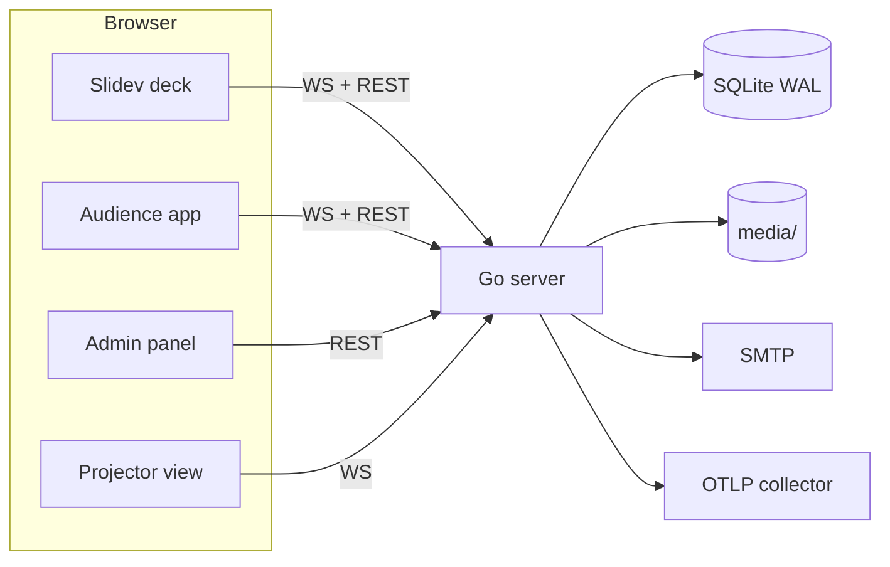

# Slides

**Slides** is a monorepo for hosting multiple [Slidev](https://sli.dev) decks
together with the Go server that powers **live audience interaction** inside
them — polls, quizzes, word clouds, Q&A, moderation and post-event recaps.

Each deck lives in `decks/<name>/` as an npm workspace. The backend lives in
`server/` and can serve the built decks, the audience app, the admin panel and
the WebSocket API from a single container — or you can keep hosting static decks
on GitHub Pages and point them at a hosted backend.

<div class="grid cards" markdown>

-   :material-presentation:{ .lg .middle } **Decks**

    ---

    Author Slidev decks in markdown with interactive slides, live components,
    a presenter panel, quizzes and Q&A.

    [:octicons-arrow-right-24: Browse decks](decks.md)

-   :material-comment-question:{ .lg .middle } **Questions**

    ---

    Eight question kinds, media prompts, scoring, time limits and the quiz loop.

    [:octicons-arrow-right-24: Question kinds](questions.md)

-   :material-cog:{ .lg .middle } **Configuration**

    ---

    Every environment variable, the admin settings, OIDC, CORS, analytics and OTel.

    [:octicons-arrow-right-24: Configure](configuration.md)

-   :material-rocket-launch:{ .lg .middle } **Deployment**

    ---

    Docker, Compose profiles, GitHub Pages and hosted-backend wiring.

    [:octicons-arrow-right-24: Deploy](deployment.md)

</div>

## Why Slides

<!-- prettier-ignore -->
- **One binary** — the Go server serves the decks, audience app, projector view,
  admin panel, API and WebSocket, with an embedded vanilla-JS frontend.
- **Works offline** — a deck that cannot reach a backend still renders, just
  without live features.
- **Live questions** — poll, multi-select, ranking, yes/no, rating, NPS, open
  text, word cloud and a 2×2 scatter board, each with an optional image or video
  prompt.
- **Markdown-authored** — declare questions as interactive slide layouts
  (`layout: poll`) or as inline `<!-- live-question -->` blocks, and the server
  seeds and auto-activates them.
- **Quiz game loop** — per-question timers with auto-lock, host reveal, deferred
  scoring and a top-3 podium.
- **Q&A with moderation** — upvoting, an opt-in content filter, an
  approve/hide queue and per-event slow mode.
- **Post-event recap** — a gated public results page, attendee email opt-ins and
  a plain-text recap email.
- **SSO-ready** — local accounts plus any OIDC provider (Authelia, Keycloak,
  Authentik, Okta, Entra ID).
- **Observable** — Umami analytics and OpenTelemetry traces, metrics and logs.
- **No extra infrastructure** — SQLite in WAL mode; no Redis or memcached.

## Quick start

=== "Run the backend"

    ```bash
    cd server
    go run .            # http://localhost:6270
    ```

    Open `/admin` to create the first admin user, then create an event.

=== "Develop a deck"

    ```bash
    npm install
    npm run dev -w meetup   # hot-reload deck on http://localhost:3030
    ```

=== "Run everything in Docker"

    ```bash
    docker compose up -d    # slides on http://localhost:6270
    ```

## How the pieces fit



See [Architecture](architecture.md) for the full walk-through.

## Where to go next

- New here? Start with [Getting started](getting-started.md).
- Building a talk? Read [Decks](decks.md) and [Questions](questions.md).
- Self-hosting? Read [Configuration](configuration.md) and [Deployment](deployment.md).
- Integrating? Read the [API reference](api.md).
